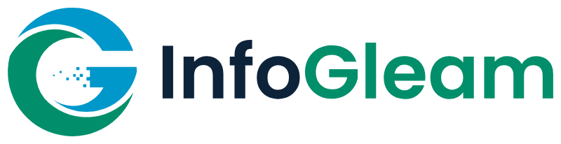

# Hisham Alrashdan

**Healthcare integration engineer** at [InfoGleam](https://infogleam.com), Irbid, Jordan.

I build and support HL7 v2 and FHIR interfaces on **Open Integration Engine (OIE)** and **Mirth Connect**.

## What I do

- **HL7 and FHIR interfaces:** connect EMR and HIS systems with lab, radiology, billing and dental systems.
- **Mirth Connect and OIE:** security updates, moving from Mirth to OIE, and custom plugins.
- **Open Dental integration:** HL7 links and API connectors for Open Dental.

## Open-source projects

| Project | What it is |
|---|---|
| [smart-fhir-starter-kit](https://github.com/Hisham-InfoGleam/smart-fhir-starter-kit) | A learning kit for SMART on FHIR and HL7 v2, with an OIE / Mirth channel |
| [infogleam-health-poc](https://github.com/Hisham-InfoGleam/infogleam-health-poc) | HL7 v2 ADT to FHIR Patient on OIE and Mirth Connect, with a Node.js converter |
| [smart-epic-salesforce](https://github.com/Hisham-InfoGleam/smart-epic-salesforce) | SMART on FHIR demo for the Epic sandbox, with a Salesforce sample |

## Contact

- Website: [infogleam.com](https://infogleam.com)
- Email: [hisham@infogleam.com](mailto:hisham@infogleam.com)
- Upwork: [hire me on Upwork](https://www.upwork.com/freelancers/~01373fa5211683c623)
